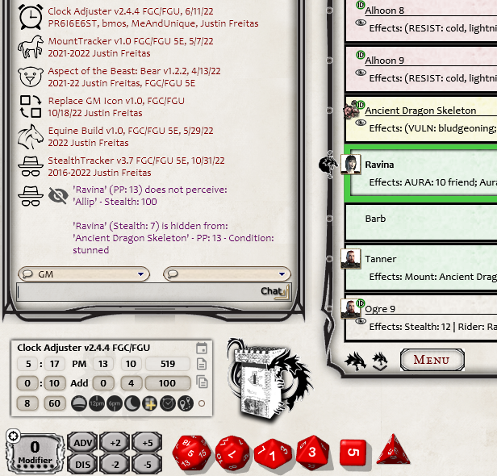

# StealthTracker for D&D 5E (Fantasy Grounds Unity & Classic)

**StealthTracker** is a Fantasy Grounds extension for the **D&D 5E** ruleset that automates stealth tracking in combat and resolves contested Stealth rolls against Passive Perception in real time.

When an actor rolls Stealth, the total result is automatically tracked as a Combat Tracker (CT) effect (`Stealth: [Total]`). The extension monitors observer Passive Perception scores, evaluates who can perceive or is hidden from whom, provides real-time notifications to the GM in chat, and evaluates advantage on attacks made from stealth.

---

## Key Features

1. **Automated Stealth Tracking**:
   * Rolling a **Stealth** check automatically records the result as a Combat Tracker effect: `Stealth: [Total]`.
   * Can be configured to track on the actor's turn, out of turn, or out of combat.

2. **Contested Stealth vs. Passive Perception**:
   * Evaluates the active actor's stealth roll against the **Passive Perception** of other combatants in the Combat Tracker.
   * PC Passive Perception is read directly from the character sheet.
   * NPC Passive Perception is parsed from their `senses` field (e.g. `passive Perception 14`). If senses are missing, it accurately computes `10 + Wisdom modifier` (plus proficiency bonus when applicable per 5E RAW).
   * Fully accounts for advantage or disadvantage (+5 / -5) on Passive Perception, including 2014 Exhaustion penalties.

3. **Turn-Start Awareness Summaries**:
   * Advancing the turn in the Combat Tracker (via the Next Actor button or clicking the active turn indicator) automatically evaluates which hiding actors the current combatant can perceive and which ones remain hidden.

4. **Attack from Stealth & Advantage Evaluation**:
   * When an actor attacks from stealth, StealthTracker evaluates whether the target perceives them.
   * If the attacker is unseen by the target, the GM is notified in chat that the attacker was hidden and qualifies for advantage on the attack roll per 5E rules.

5. **Automated Stealth Expiration**:
   * Performing an attack (melee, ranged, or spell attack) or completing a combat round automatically expires the actor's `Stealth` effect (configurable via GM options).

6. **NPC Stealth Skill Generation**:
   * When an NPC without a configured Stealth skill is added to or activated in the Combat Tracker, StealthTracker automatically adds `Stealth +[DEX mod]` to their CT skills list, allowing the GM to roll stealth with a single click.

7. **Dice Tower & Secret Roll Privacy**:
   * Stealth rolls dropped into the Dice Tower or flagged secret (`[TOWER]`, `[GM]`) automatically create GM-only Combat Tracker effects (`isgmonly = 1`) and suppress public announcements, keeping stealth results confidential even if player visibility options are turned on.

8. **Stealth Effect Modifiers (Cloak of Elvenkind)**:
   * Supports stealth-modifying items and effects such as the **Cloak of Elvenkind** (which imposes disadvantage / a -5 penalty to observer sight-based Passive Perception).
   * Chat messages display the effective score and calculation breakdown (e.g. `PP: 10 [15 - 5]`).

9. **Chat Roll Drag-and-Drop**:
   * The GM can drag any stealth roll total from the chat log and drop it directly onto an actor in the Combat Tracker to assign or override their stealth value.

---

## Chat Commands

| Command | Description |
| :--- | :--- |
| `/stealth` | Runs an immediate awareness evaluation for the active combatant, reporting who they can and cannot perceive. |
| `/stealth clear` | Immediately removes all `Stealth: #` effects from all actors across the Combat Tracker. |

---

## Configuration Settings (GM Options)

StealthTracker options can be found in Fantasy Grounds under the **Options** window in the **StealthTracker (GM)** section:

* **Player: Out of turn or combat Stealth** (`STEALTHTRACKER_ALLOW_OUT_OF`)
  * *None (Default)*: Stealth tracking only triggers during combat on the actor's active turn.
  * *Turn*: Allows stealth tracking out of combat when it is the actor's turn.
  * *Turn and Combat*: Allows stealth tracking out of turn and out of combat.

* **CT: Expire Stealth effect** (`STEALTHTRACKER_EXPIRE_EFFECT`)
  * *Attack and Round (Default)*: Automatically expires the `Stealth` effect when making an attack or at the end of the round.
  * *Attack*: Expires stealth only upon making an attack roll.
  * *None*: Stealth effects persist until manually cleared.

* **CT: Ignore Stealth same faction** (`STEALTHTRACKER_FACTION_FILTER`)
  * *On (Default)*: Allies within the same faction ignore stealth checks against one another (e.g. PCs do not hide from fellow party members).
  * *Off*: Evaluates stealth against every actor in the Combat Tracker regardless of faction.

* **Player: Show Stealth info** (`STEALTHTRACKER_VISIBILITY`)
  * *Effects (Default)*: Displays `Stealth: [Total]` effects to players on the Combat Tracker (unless rolled secretly).
  * *Chat and Effects*: Displays both chat summary announcements and Combat Tracker effects to players.
  * *None*: Hides all stealth effects and chat output from players (effects are marked GM-only).

* **Chat: General verbosity** (`STEALTHTRACKER_VERBOSE`)
  * *Standard (Default)*: Standard reporting of hidden and spotted statuses.
  * *Max*: Verbose output with additional situational details (such as notifications when a target spots an ambush).
  * *Off*: Silences general StealthTracker chat reporting.

* **Chat: 'Sees Actor' verbosity** (`STEALTHTRACKER_AWARE`)
  * *Both (Default)*: Reports both observers who spot the hiding actor and observers who fail to perceive them.
  * *Aware*: Only reports observers who successfully perceive the hiding actor.
  * *Unaware*: Only reports observers who fail to perceive the hiding actor.
  * *None*: Suppresses the 'Sees Actor' summary.

* **Chat: 'Actor Sees' verbosity** (`STEALTHTRACKER_VISIBLE`)
  * *Hidden (Default)*: Reports only hidden opponents that the active actor cannot perceive.
  * *Visible*: Reports opponents that the active actor can perceive.
  * *Both*: Reports both visible and hidden opponents.
  * *None*: Suppresses the 'Actor Sees' summary.

* **CT: Remove Stealth on Init Clear** (`STEALTHTRACKER_INIT_CLEAR`)
  * *On (Default)*: Automatically cleans up all `Stealth` effects from the Combat Tracker when clearing initiative via the CT menu.
  * *Off*: Retains stealth effects when initiative is cleared.

* **Chat: Show summary after Stealth** (`STEALTHTRACKER_SHOW_AFTER_STEALTH`)
  * *On (Default)*: Posts the awareness summary to GM chat immediately after an actor rolls Stealth.
  * *Off*: Awareness summary only fires upon turn activation or manual command.

* **Chat: Frame style** (`STEALTHTRACKER_FRAME_STYLE`)
  * *None (Default)*: Unbordered text formatting.
  * *Chat / Story / Whisper*: Styles StealthTracker announcements with native CoreRPG box frames.

* **Chat: Show Hidden (eye) Icon** (`STEALTHTRACKER_SHOW_EYE`)
  * *Off (Default)*: Omits the eye icon on secret messages to conserve chat space.
  * *On*: Displays the secret eye icon next to GM-only chat messages.

---

## Best Practices & Tips

* **Clearing Initiative at Encounter End**: At the end of combat, clear the initiative via the Combat Tracker menu (**Menu** &rarr; **Clear Initiative**) or execute `/stealth clear`. This cleans up stealth data and ensures fresh TurnStart events when the next encounter begins.
* **Advancing Combat**: To start an encounter and cycle turns, use the **Next Actor** button or click directly on an actor's turn indicator in the Combat Tracker. Simply moving the round marker will not fire activation hooks.
* **Unidentified NPCs**: StealthTracker fully respects the unidentified state of creatures on the Combat Tracker. Monster names in chat output appear as `(unidentified)` or their assigned unidentified label, ensuring no player spoilers.
* **Generic Actions Extension**: StealthTracker automatically intercepts and processes **Hide** actions rolled from the *Generic Actions* extension.

---

## Installation

> **Compatibility**: Designed for **Fantasy Grounds Unity (FGU)** and **Fantasy Grounds Classic (FGC)** v3.3.15+ under the **D&D 5E** ruleset.

### Recommended: Fantasy Grounds Forge

Install directly via the [Fantasy Grounds Forge](https://forge.fantasygrounds.com/). Forge handles installation and provides seamless automatic updates whenever a new version is released.

### Manual / Developer Build

1. Download or package the repository into `StealthTracker.ext` using `build/package.ps1` or your preferred zip tool (store as a `.zip` without top-level folder wrapping, then rename extension to `.ext`).
2. Copy `StealthTracker.ext` into your Fantasy Grounds `extensions` directory:
   * Windows: `%APPDATA%\SmiteWorks\Fantasy Grounds\extensions\`
3. Enable **Feature: StealthTracker** in the Extensions list when loading your 5E campaign.

---

## Changelog

### v5.8.1
* **CoreRPG Initiative Sync Hardening (Nov 2026)**: Added `sInitSource = "turn"` on duration-2 fractional stealth effects during round and action-based expiration checks to maintain full compatibility with CoreRPG `ActorEffectManager.onInitResultUpdate` and prevent ruleset initiative synchronization from resetting fractional sub-turn offsets.
* **Immediate NPC Stealth Skill Population & Live Sheet Refresh**: Hooked `CombatRecordManager` NPC post-add (with FGC `CombatManager.setCustomAddNPC` parity) and campaign load (`onTabletopInit` / `Interface.onDesktopInit`) so `Stealth +[DEX mod]` is populated as soon as an NPC enters the Combat Tracker rather than waiting for its first turn. Also refreshes already-open locked NPC sheets (including resetting cached multi-roll skill offsets across 2024/2014/FGC layouts) and supports en-dash negative skill modifiers (`Stealth –1`).

### v5.8
* **Dice Tower & Secret Roll Privacy**: Stealth rolls made in the Dice Tower or secretly (`rRoll.bSecret` / `rRoll.bTower`, or secret chat rolls dragged onto the CT) now automatically mark the resulting `Stealth: X` effect as GM-only (`isgmonly = 1`) and suppress public chat announcements even when `Player: Show Stealth info` is set to `Effects` or `Chat and Effects`.
* **Client-Side Option Lookup & Roll Pre-Hook**: Fixed `isPlayerStealthInfoDisabled()` on player clients by falling back to `DB.getValue("options.STEALTHTRACKER_VISIBILITY", "")`, and hooked `ActionsManager.performAction` so Stealth rolls are marked secret before dice are thrown when visibility is `None` or the actor is hidden.
* **Combat Tracker Chat-Roll Drag-and-Drop**: Hooked `CombatDropManager.handleAnyDrop` directly in `onInit()` to ensure chat roll total drags reliably update CT stealth effects across modern CoreRPG.
* **Cloak of Elvenkind Restoration**: Restored `STEALTH_EFFECT_MODIFIERS` (-5 observer Passive Perception penalty) and updated chat output to display the calculation breakdown for modified Passive Perception (e.g. `PP: 10 [15 - 5]`).
* **Unidentified NPC Name Protection**: Centralized `getActorDisplayNameSafe()` across all chat messages to prevent leaking the true identity of unidentified NPCs.
* **NPC Skill Detection**: Made NPC Stealth skill detection case-insensitive with flexible whitespace.

### v5.7.3
* **Fantasy Grounds Classic (FGC) Compatibility**: Restored full dual FGC/FGU compatibility. Captures `ActionSkill.onRoll` and `ActionAttack.onAttack` when `ActionsManager.getResultHandler` is absent in FGC.
* **Safe Actor Resolution**: Fixed `getActorSafe` on FGC by resolving via `ActorManager.resolveActor`, restoring turn activation analysis and NPC skill population.
* **Attack from Stealth Fix**: Fixed attack advantage evaluation when attacking a non-hiding target.
* **Exhaustion Disadvantage in PP**: Restored 2014 Exhaustion disadvantage in Passive Perception calculations.

### v5.7.2
* **Action Resolution Modernization**: Restored roll resolution hooking via `ActionsManager` result handlers to ensure skill and attack observers trigger reliably after ruleset processing.
* **Node Path Resolution**: Fixed database node path resolution for userdata `databasenode` references in FGU.
* **Drop & DB API Standards**: Standardized on modern `CombatDropManager` registration and direct `DB` package functions (`DB.deleteNode`, `DB.getValue`, `DB.setValue`).

### v5.7.1
* Cleaned up verbose debug trace console logging across attack rolls, skill rolls, duplicate actor resolution, and turn checks.

### v5.7
* Fixed double-decoding on Generic Actions Hide rolls by skipping redundant advantage/disadvantage decoding when already handled by the ruleset.

### v5.6
* Fixed issue where Stealth effects remained visible to players on the Combat Tracker when `Player: Show Stealth info` was set to `None`. Explicitly set `isgmonly = 1` on created effect nodes.

### v5.5
* Added duplicate actor matching (turn check redirection, name-based NPC/PC targeting, and drag-and-drop fallback).
* Added parsing/expiration of GM-only parenthesized stealth effects (e.g. `(Stealth: 18)`) on NPC attacks.

### v5.4
* Added `getResultHandlerSafe` helper to guard against FGC nil errors with `ActionsManager.getResultHandler`.

### v5.3
* Corrected default Passive Perception fallback to `10 + Wisdom modifier` (RAW) rather than unconditionally adding proficiency bonus.
* Hardened `booleanToNumber` and guarded aware/unaware summaries against nil values.

### v3.7 – v3.20
* **v3.20**: Added support for **Cloak of Elvenkind** (-5 PP penalty to observers).
* **v3.19**: Forced removal of stealth effects when triggered from chat commands.
* **v3.18**: Added option to display the Hidden (eye) icon on secret chat messages.
* **v3.17**: Chat frame adjustments and replaced condition checks with safe `EffectManager.hasEffect` calls.
* **v3.16**: Added `Chat: Frame style` option (None, Chat, Story, Whisper).
* **v3.15**: Restricted options to GM window and accounted for advantage/disadvantage in Passive Perception.
* **v3.12 – v3.14**: Icon modernizations and chat announcement formatting.
* **v3.10 – v3.11**: Triggered combat stealth checks on `requestActivation`, added unidentified creature name handling, and fixed NPC proficiency bonus fractions.
* **v3.8 – v3.9**: Added `Chat: 'Actor Sees' verbosity` and `CT: Remove Stealth on Init Clear` options.
* **v3.7**: Added aware/unaware summary display options.

### v1.1 – v3.6.4
* **v3.6**: Added verbosity options to tune or disable StealthTracker chat output.
* **v3.5**: Faction filtering support, massive chat verbosity reduction, and out-of-combat tracking options.
* **v3.4**: Added support for *Generic Actions* extension Hide actions.
* **v3.3**: Added localized string lookup support for non-English rulesets.
* **v3.2**: Added DEX modifier calculation for automatically generated NPC Stealth skills.
* **v3.0**: Introduced tri-state player visibility options to completely hide stealth info from players.
* **v2.0 – v2.9**: Migrated stealth tracking from actor names to Combat Tracker effects; automated stealth expiration on attacks; added drag-and-drop roll assignment.
* **v1.1 – v1.3**: Initial releases introducing `/stealth` chat commands, automatic roll detection, and advantage evaluation.

---

